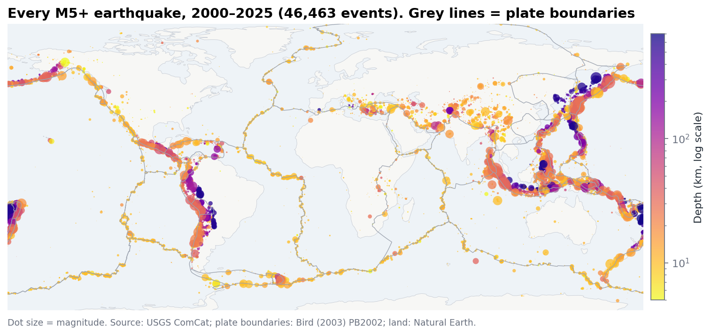
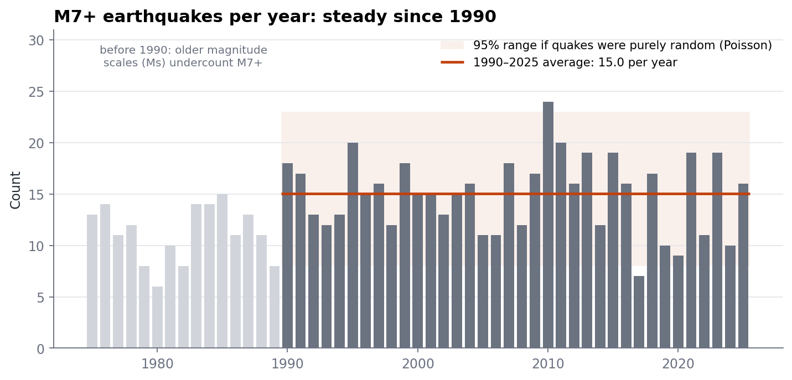
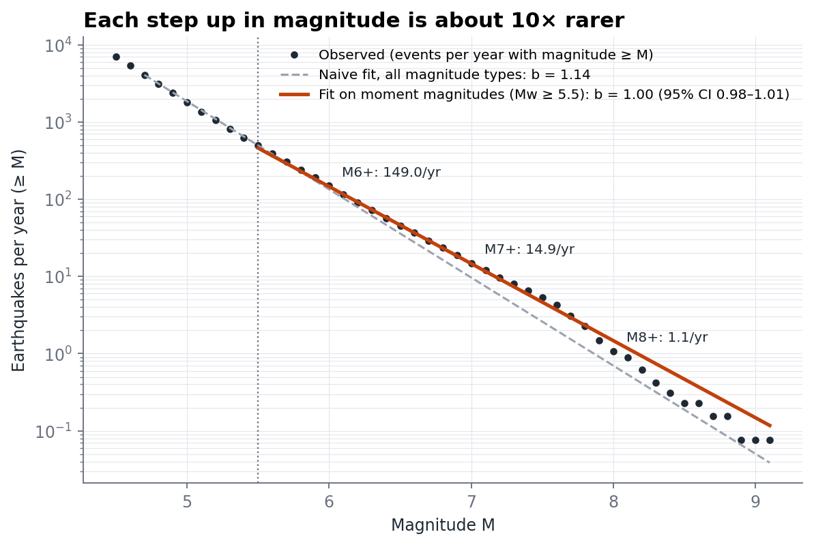
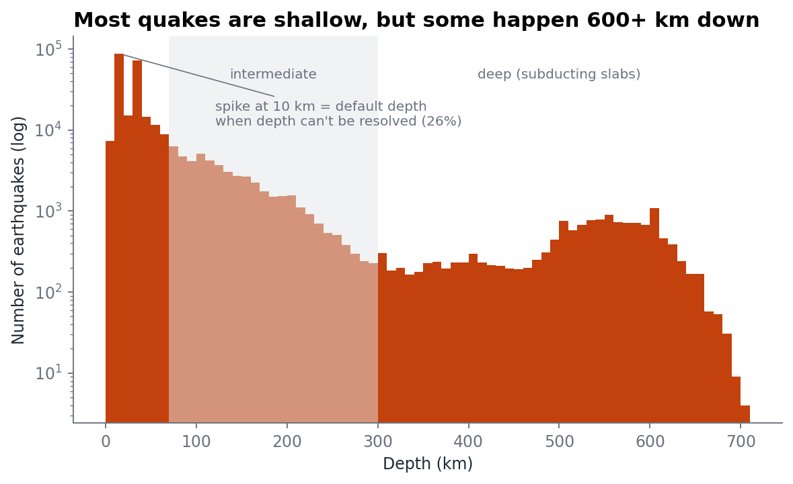

# World Earthquakes, 1975–2025

A small, honest look at **281,854 earthquakes of magnitude 4.5+** from the USGS catalog: where they happen, how their sizes are distributed, whether big ones are becoming more common, and how deep they go.



## Findings

| Question | Answer |
|---|---|
| Where? | **66%** of M4.5+ quakes lie within 100 km of a plate boundary, vs **9.5%** of random points on Earth (7× more than chance). |
| How much rarer are bigger quakes? | **b = 1.00** (95% CI 0.98–1.01): each +1 in magnitude is **~10× rarer**. Per year: ~149 M6+, ~15 M7+, ~1 M8+. |
| Are big quakes increasing? | **No.** Since 1990, M7+ counts average 15.0/yr with Poisson-like variation (dispersion index 0.92) and no trend (−2.4%/decade, p = 0.56). |
| How deep? | 77% shallow (<70 km), 18% intermediate, 5% deep (300–700 km, inside sinking slabs). Deepest: 701 km. |

## Two data traps this project ran into

**1. A fake upward trend.** Over 1975–2025, M7+ counts appear to rise **+6% per decade (p = 0.02)**. However, 90% of 1970s M7+ events were measured on older scales (mostly surface-wave Ms), which underestimate large quakes, versus 0% after 1990. Restricting to the moment-magnitude era removes the trend entirely.



**2. A biased b-value.** Fitting all events gives b = 1.14 (each step "14× rarer"). However, 80–96% of M4–5 events use body-wave magnitude (mb), which saturates for large quakes, so the catalog mixes two scales. Using only moment magnitudes (Mw ≥ 5.5) gives **b = 1.00**, the textbook value.



A third, smaller one: 26% of events sit at **exactly 10 km depth**. That is the default depth assigned when depth can't be resolved, not a real physical peak.



## Method

- **Data:** USGS ComCat FDSN event service, M ≥ 4.5, 1975–2025, downloaded year by year (the API returns max 20,000 events per query). The download matches the API's own count exactly (281,854); 594 non-earthquake events (explosions, quarry blasts, etc.) are dropped, leaving 281,260.
- **Plate-boundary distance:** haversine nearest-neighbour search (scikit-learn `BallTree`) against PB2002 boundaries densified to 0.1°. Compared with 50,000 points drawn uniformly on the sphere.
- **b-value:** Aki–Utsu maximum-likelihood estimator with binning correction; 95% CI from 500 bootstrap resamples. Completeness: maximum-curvature method for the naive fit; Mw ≥ 5.5 for the main fit.
- **Trend:** Poisson regression (GLM) of yearly M7+ counts on year; over-dispersion via the variance/mean index with a χ² test.

## Run

```bash
pip install pandas numpy scipy scikit-learn statsmodels geopandas matplotlib
python analyze.py          # reads data/raw/, writes output/
```

**Data sources:** [USGS Earthquake Catalog](https://earthquake.usgs.gov/fdsnws/event/1/) · Bird (2003) PB2002 plate boundaries via [fraxen/tectonicplates](https://github.com/fraxen/tectonicplates) · [Natural Earth](https://www.naturalearthdata.com/) 1:110m land.

*Author: Axror Abduhamitov, 2026*
